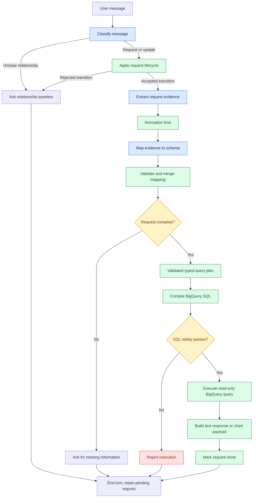

# Grounded LangGraph SQL Agent

[](https://github.com/mahasa-amini/grounded-langgraph-sql-agent/actions/workflows/offline-tests.yml)

A backend reference project for turning natural-language sensor-data questions into validated, read-only BigQuery SQL. It demonstrates LangChain structured outputs, LangGraph conversation state, schema-grounded request mapping, deterministic SQL compilation, fail-closed SQL validation, and structured text/chart response contracts.

This repository contains the Python backend only. It does not provide a web UI or render charts.

## Verified engineering outcomes

| Outcome | Evidence |
|---|---|
| Repeatable offline verification | **95 tests passed**, including lifecycle, compiler, SQL-safety, output, and whole-runner regressions; [CI workflow](.github/workflows/offline-tests.yml) |
| Real BigQuery integration | **Nonempty raw flow retrieval and scalar average aggregation** matched independent reference queries through the actual natural-language graph on 2026-10-13 |
| Reliable SQL construction | Validated typed plans compile through a deterministic BigQuery AST builder; the normal graph makes **no SQL-model call** |
| Request replacement | Two recorded conversations cleared stale location, chart, and aggregation state and reached the labelled execution stub |
| Bounded live verification | Four live read-only SELECTs, each preceded by a dry run and capped at 100 MiB; **zero database modifications** |

The live result is evidence for the two recorded requests and their frozen selection, not a general model-accuracy benchmark. The offline suite, synthetic demo, and live verification test different boundaries.

See [real BigQuery evidence](evaluations/public/real_bigquery_verification_2026-10-13.md) and [replacement evidence](evaluations/public/replacement_paths_2026-10-12_deterministic_sql_173646_llama3_2_latest.public.md).

## What the backend does

The overview below groups the active-request path. General chat, schema questions, cancellation, and goodbye routes are expanded in the [message-routing diagram](docs/architecture.md#message-routing).



The model interprets language; it does not write the SQL used by the normal supported path. `SQL_MODEL` remains a configuration field for the retained diagnostic-only legacy SQL chain, but it is not invoked by normal deterministic compilation.

See [Architecture](docs/architecture.md) for component and trust-boundary details.

## Current capabilities

- Multi-turn data and chart requests with clarification, correction, cancellation, replacement, and schema-side-question handling.
- Schema-grounded mappings for the configured `sensor_measurements` logical table.
- Raw timestamp/value projection and scalar or grouped `AVG`, `SUM`, `MIN`, `MAX`, and `COUNT` plans.
- Typed filters using `=`, `!=`, `>`, `>=`, `<`, `<=`, `IN`, and `BETWEEN`.
- Absolute, relative, and named time ranges normalized to half-open intervals (`start <= timestamp < end`).
- Validated grouping, ordering, `DISTINCT`, aggregate `HAVING`, and bounded `LIMIT`.
- Fail-closed SQL parsing and validation before the execution node.
- Deterministic Markdown text responses and backend-only line, bar, or table payloads.
- Logical-to-physical BigQuery table replacement only at the execution boundary.

Current intentional limitations:

- One configured logical table and one metric family (`flow` mapped to `value`).
- No joins, set operations, mutation statements, wildcard/qualified source tables, arbitrary SQL expressions, or user-provided SQL fragments.
- No typed time-bucket contract. Bucketed time-series requests are rejected rather than silently degraded.
- Chart payload creation only; no chart rendering or frontend integration.
- Model interpretation remains sensitive to the installed model and can require clarification or fail safely.

The authoritative schema and capability declarations are in [`schema/`](schema/).

## Project layout

```text
agent/       LangGraph nodes, routers, prompts, lifecycle, and state
app/         typed runtime configuration
db/          BigQuery execution adapter
models/      Ollama factories and Pydantic structured outputs
schema/      database, public, semantic, and requirement declarations
tools/       deterministic mapping, validation, time, safety, and SQL tools
tests/       offline unittest regression suite
scripts/     CLI, offline demo, diagnostics, and guarded evaluations
evaluations/ retained reports and traces
docs/        architecture and evaluation guidance
```

## Requirements and installation

The supported release environment is Python 3.13. The dependency set is pinned in [`requirements.txt`](requirements.txt); [`requirements-macos-py313.lock.txt`](requirements-macos-py313.lock.txt) is a full snapshot of the working macOS arm64 environment, not a cross-platform lock guarantee.

This is currently a source-checkout application rather than an installable Python distribution: there is no `pyproject.toml` or published wheel. Commands use the repository root on `PYTHONPATH`.

```bash
python3.13 -m venv .venv
source .venv/bin/activate
python -m pip install -r requirements.txt
```

No Ollama server or cloud credentials are needed for the offline tests or synthetic demo.

## Configuration

Copy [`.env.example`](.env.example) only when running the interactive backend or an explicitly guarded evaluation:

```bash
cp .env.example .env
```

The template contains placeholders only. A minimal shape is:

```env
APP_ENV=development
GROUNDED_SQL_AGENT_DEBUG=false
AGENT_DEBUG=false

LLM_PROVIDER=ollama
OLLAMA_BASE_URL=http://localhost:11434
DEFAULT_OLLAMA_MODEL=<installed-local-model>
INTERPRET_MODEL=<installed-local-model>
MAPPING_MODEL=<installed-local-model>
CLARIFICATION_MODEL=<installed-local-model>
SQL_MODEL=<unused-in-normal-compiler-path>
ANSWER_MODEL=<installed-local-model>

GCP_PROJECT_ID=<gcp-project-id>
BIGQUERY_DATASET_ID=<bigquery-dataset-id>
BIGQUERY_TABLE_ID=<bigquery-table-id>
BIGQUERY_LOCATION=<bigquery-location>
BIGQUERY_LOGICAL_TABLE_NAME=sensor_measurements

LANGSMITH_TRACING=false
LANGCHAIN_TRACING_V2=false
```

Never commit `.env`, credential files, or private runtime state. Pydantic Settings reads `.env` for normal local execution; the documented tests and evaluations use isolated working directories and explicit environment values instead.

## Run the backend

Interactive CLI, requiring configured local Ollama models and a database connection for completed requests:

```bash
PYTHONPATH=. AGENT_DEBUG=false python -m scripts.run_cli
```

LangGraph development server:

```bash
langgraph dev
```

The graph entry points are:

- `agent.graph:app` — graph with the in-memory checkpointer used by the CLI.
- `agent.graph:server_app` — graph without an embedded checkpointer for the LangGraph server.

## Offline tests

The suite uses `unittest` and mocks external boundaries. It does not require Ollama, BigQuery, credentials, `.env`, or tracing.

From the repository root:

```bash
PYTHONPATH=. AGENT_DEBUG=false GROUNDED_SQL_AGENT_DEBUG=false \
python -m unittest discover -s tests -v
```

For stricter isolation:

```bash
cd /tmp
env -i PATH=/usr/bin:/bin:/usr/sbin:/sbin \
  PYTHONPATH=/path/to/grounded-sql-agent \
  AGENT_DEBUG=false GROUNDED_SQL_AGENT_DEBUG=false \
  /path/to/grounded-sql-agent/.venv/bin/python \
  -m unittest discover -s /path/to/grounded-sql-agent/tests -v
```

The 2026-10-13 complete offline suite passed **95 tests: 95 passed, 0 failed, 0 skipped**, including eight whole-runner regressions with synthetic SDK responses and guarded model/cloud boundaries. These tests verify application behavior with mocks; real-model and database evidence are recorded separately.

CI runs the same offline suite on Python 3.13 using [`.github/workflows/offline-tests.yml`](.github/workflows/offline-tests.yml).

## Backend-only synthetic demo

[`scripts/demo_backend.py`](scripts/demo_backend.py) demonstrates a clarification transcript, typed plan, deterministic compilation, mandatory safety validation, a labelled synthetic execution result, a text response, and a chart payload.

```bash
PYTHONPATH=. AGENT_DEBUG=false python -m scripts.demo_backend
```

The demo makes no model or database calls. Its row values are synthetic fixture data and are labelled `SYNTHETIC_FIXTURE_NO_DATABASE_EXECUTION`. The chart output is a JSON-ready backend payload, not a rendered visualization.

## Evaluation evidence

Evaluation claims are intentionally separated:

- **Offline tests** verify deterministic parsing, lifecycle, reducers, compilation, safety routing, and output contracts with mocks.
- **Real-model runs** measure local Ollama interpretation and mapping behavior; deterministic safeguards are not counted as model accuracy.
- **Labelled-stub runs** exercise the graph through SQL validation but do not execute BigQuery or validate real rows.
- **Database execution** was verified in a bounded real-BigQuery run for both
  nonempty raw retrieval and scalar average aggregation through the actual
  natural-language graph, with independent reference agreement. This is a
  narrow operational result for the frozen selection, not a general accuracy
  claim.

The sanitized operational record keeps the successful run separate from the
earlier empty-selection and stopped preview attempts:

- [Real BigQuery verification evidence](evaluations/public/real_bigquery_verification_2026-10-13.md)

The latest deterministic-compiler replacement run completed both supplementary scenarios, made 15 non-SQL model calls, made zero SQL-model calls, reached the labelled execution stub twice, and recorded zero database attempts:

- [Public human-readable replacement report](evaluations/public/replacement_paths_2026-10-12_deterministic_sql_173646_llama3_2_latest.public.md)
- [Public redacted replacement JSON trace](evaluations/public/replacement_paths_2026-10-12_deterministic_sql_173646_llama3_2_latest.public.json)

Those two successful supplementary scenarios demonstrate active-request replacement for their fixed inputs only. They do not imply that every conversation scenario passes.

Earlier comparison and SQL-replay reports are historical evidence from a different, model-generated SQL path or from pre-fix behavior. They remain useful diagnostic records but should not be presented as validation of the current deterministic compiler. See [Evaluation guide](docs/evaluation.md).

Optional real-Ollama evaluations are deliberately separate from CI. Run them only after inspecting their guard installation, fixed fixtures, expected model metadata, timeout, and output paths. They must use explicit non-secret configuration, tracing disabled, and the existing BigQuery construction/execution guards. The repository does not provide a generic “safe by default” command for arbitrary evaluation inputs.

## Safety boundary

The compiler accepts only typed fields validated against the configured schema and requirements. The subsequent SQL validator independently requires one read-only `SELECT`, the permitted logical table, and a literal bounded outer `LIMIT`. Rejected compilation or validation cannot route to execution.

This is a narrow application policy, not a general-purpose SQL sandbox. Operators should still apply least-privilege BigQuery credentials, dataset permissions, quotas, and billing controls for any real deployment.

## Output contracts

Text output is deterministic Markdown containing an execution summary, a bounded row preview, and the SQL when available. Empty and error results have explicit messages.

Chart output is JSON-compatible data with a `type`, title, data, and—when applicable—`x_key`, `y_key`, labels, and series metadata. If usable axes cannot be established, the backend returns a table payload. See [Architecture](docs/architecture.md#output-boundary).

## License and data provenance

This project is licensed under the [MIT License](LICENSE), Copyright (c) 2026 Mahasa Amini.

No company dataset is included. The unused historical export filename was removed from the public schema after confirming that runtime code does not consume it. The schema-derived sensor examples and Marene location catalog are published with the project owner's authorization. Third-party dependencies retain their own licenses and attribution; no vendored third-party source or notice was removed.

## Release status

Backend code, offline tests, deterministic compilation, CI configuration, and a synthetic demo comprise the first backend release.
