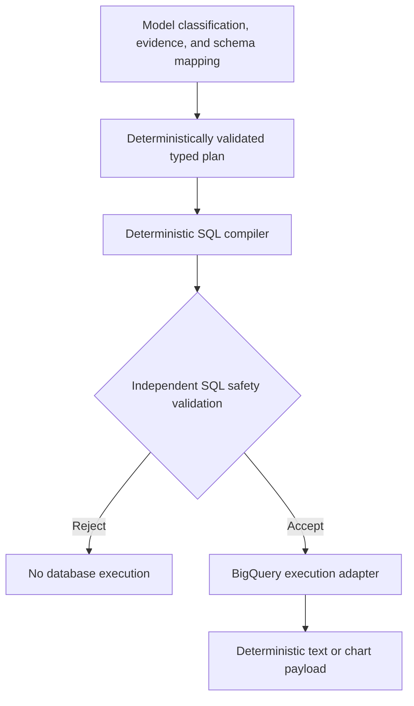
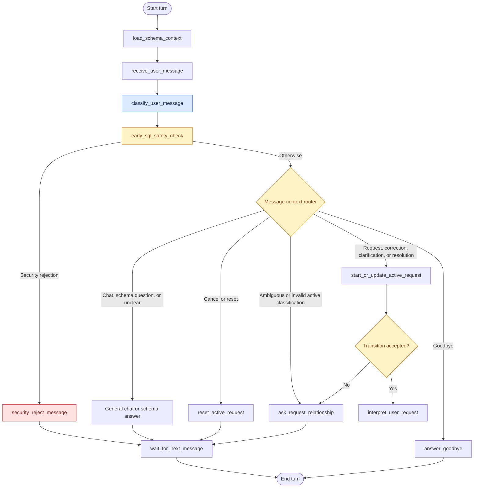
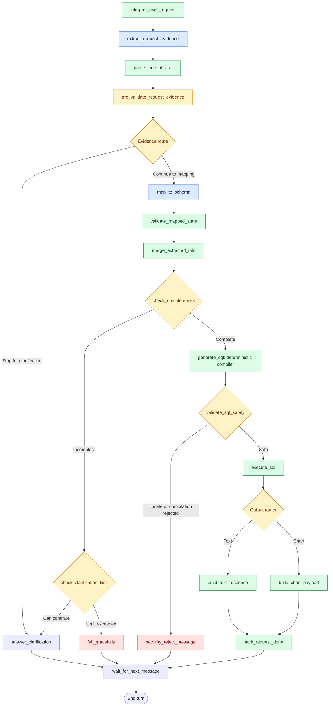

# Backend architecture

## Trust boundaries



The first stage is probabilistic. Structured model outputs are parsed into Pydantic contracts and then subjected to deterministic lifecycle and schema checks. Classification safeguards may preserve state or request clarification; those safeguards are application behavior, not evidence that the model interpreted the message correctly.

The normal SQL path begins only after completeness and mapping validation. `tools/sql_compiler_tool.py` accepts typed state fields, validates them against `schema/database_schema.yaml` and `schema/requirements.yaml`, and builds a BigQuery AST with `sqlglot`. It never accepts an arbitrary expression or SQL fragment from the user.

`agent/nodes/sql_safety.py` is a second mandatory gate. It parses the compiled SQL independently and enforces a single read-only `SELECT`, the configured logical source, and a bounded outer `LIMIT`. Only the safe route reaches `agent/nodes/sql_execution.py`.

The legacy model-backed SQL chain remains available only through `generate_sql_with_llm_diagnostic_node`; it is not wired into `agent/graph.py`. Consequently, `SQL_MODEL` is unused for normal supported requests.

## Graph workflow

These diagrams follow [agent/graph.py](../agent/graph.py), [message routing](../agent/routers/message_router.py), and the [SQL-generation node](../agent/nodes/sql_generation.py). Router diamonds represent decisions implemented by Python router functions; they are not extra LLM calls or additional registered graph nodes.

The workflow is split into two views so that routing and query processing remain readable. The overview in [README](../README.md#what-the-backend-does) groups stages; the views below expose registered node names.

### Message routing



The combined answer box represents two registered nodes: `answer_general_chat` and `answer_schema_question`. The `unclear` route selects general chat. Invalid classification during an active collecting request selects relationship clarification; invalid idle classification follows the unclear route.

`start_or_update_active_request` applies a deterministic transition. A rejected transition returns to `ask_request_relationship`; it cannot continue to interpretation.

| Relationship | Request-state behavior |
|---|---|
| Clarification answer | Merge requested information and preserve unrelated fields |
| Correction | Replace validated target fields and invalidate derived state |
| Supported schema side question | Answer while preserving the pending request |
| New request | Initialize fresh request-scoped state and preserve conversation history |
| Cancellation/reset | Clear request-scoped and pending ambiguity state |
| Unclear relationship | Retain the unresolved message and ask whether to continue or start fresh |
| Accepted ambiguity resolution | Apply the saved message through the appropriate lifecycle transition |

### Request processing

Blue boxes identify model boundaries, green boxes identify deterministic processing, amber boxes identify checks/routing, and red boxes identify rejection or graceful failure. In particular, `interpret_user_request` derives intent and output type deterministically; it does not itself call a model.



Mapping validation contributes errors/missing slots; the graph still passes through merging and completeness checks, as shown. Missing information is clarified within the configured limit. The early evidence-clarification route is distinct from completeness-based clarification.

The registered node remains named `generate_sql`, but its implementation calls `compile_validated_sql_plan_tool`. It builds SQL from typed fields without a SQL-model call. A rejected compilation still passes to the mandatory SQL-safety node and cannot reach the safe execution route.

Both output branches mark the request done. Chart output is data for a consumer, not a rendered chart.

`wait_for_next_message -> END` finishes the current graph invocation. A subsequent user turn re-enters at `START` with the same conversation thread/checkpointer; the diagram does not imply a blocking loop inside a single invocation.

## Typed plan fields

| SQL concern | Typed state |
|---|---|
| Logical source | `table_name` |
| Raw projection | `selected_columns` |
| Measure | `metric_column` |
| Timestamp | `time_column` |
| Interval | `time_range` |
| Predicates | `filters` |
| Aggregate | `aggregation` |
| Grouping | `group_by` |
| Aggregate predicates | `having_conditions` |
| Deduplication | `distinct` |
| Ordering | `order_by` |
| Row bound | `limit` |

The compiler validates identifiers, types, functions, operators, grouping, ordering, and bounds against schema allowlists. SQL literals are emitted from typed values through AST nodes. The current database adapter accepts a SQL string and does not expose query parameters, so the compiler does not claim parameterized execution.

Time ranges use half-open intervals. An absolute day such as `2026-05-10` becomes an inclusive UTC start and exclusive next-day end. Relative and named ranges reuse the existing time predicate implementation.

## Unsupported plans

The backend rejects incomplete plans, unrecognized tables/columns, invalid types, unsupported operators, ambiguous or unsupported terms, inconsistent aggregate projections, incompatible grouping/filter combinations, unsafe limits, and malformed intervals.

The current state contract has no typed time-bucket field. Time-bucket SQL is therefore unsupported. Adding it would require a schema allowlist, a typed mapping field, compiler support, output-shape rules, and tests; it must not be passed as raw SQL.

## Execution boundary

The compiler emits the logical table `sensor_measurements`. Immediately before BigQuery execution, the adapter replaces that source with the configured fully qualified physical table. The adapter then creates a BigQuery client and normalizes returned values to JSON-compatible Python values.

Guarded Ollama/stub evaluators replace this adapter with a labelled stub and guard client construction/direct execution. Stub rows prove graph routing and output handling only; they are not database results.

The separate opt-in [real verifier](../scripts/real_bigquery_verification.py) exercises the actual graph and execution wrapper against BigQuery with explicit preview/query budgets, dry runs, and byte caps. Its recorded 2026-10-13 raw-retrieval and scalar-average checks matched independent references, with zero database modifications. See [sanitized evidence](../evaluations/public/real_bigquery_verification_2026-10-13.md). These verification controls should not be mistaken for an automatic byte cap on every ordinary backend invocation.

## Output boundary

Text responses are deterministic Markdown with a maximum ten-row preview. The response includes the SQL when available and distinguishes successful empty results from execution errors.

Chart responses are backend payloads only:

```json
{
  "type": "line",
  "title": "Value by Timestamp (line)",
  "x_key": "timestamp",
  "x_label": "Timestamp",
  "y_key": "value",
  "y_label": "Value",
  "series": [{"data_key": "value", "label": "Value"}],
  "data": [{"timestamp": "2026-05-10T00:00:00+00:00", "value": 12.34}]
}
```

No renderer, browser component, or frontend contract beyond this JSON-ready payload is included.

## State and persistence

The CLI graph uses LangGraph's in-memory checkpointer and a generated thread ID. It is process-local and is not durable storage. Request reset/cancellation clears request-scoped fields while preserving message history. Evaluation and local LangGraph runtime files are not production persistence mechanisms.
