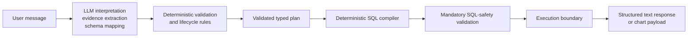

# Backend architecture

## Trust boundaries



The first stage is probabilistic. Structured model outputs are parsed into Pydantic contracts and then subjected to deterministic lifecycle and schema checks. Classification safeguards may preserve state or request clarification; those safeguards are application behavior, not evidence that the model interpreted the message correctly.

The normal SQL path begins only after completeness and mapping validation. `tools/sql_compiler_tool.py` accepts typed state fields, validates them against `schema/database_schema.yaml` and `schema/requirements.yaml`, and builds a BigQuery AST with `sqlglot`. It never accepts an arbitrary expression or SQL fragment from the user.

`agent/nodes/sql_safety.py` is a second mandatory gate. It parses the compiled SQL independently and enforces a single read-only `SELECT`, the configured logical source, and a bounded outer `LIMIT`. Only the safe route reaches `agent/nodes/sql_execution.py`.

The legacy model-backed SQL chain remains available only through `generate_sql_with_llm_diagnostic_node`; it is not wired into `agent/graph.py`. Consequently, `SQL_MODEL` is unused for normal supported requests.

## Typed plan fields

| SQL concern | Typed state |
|---|---|
| Logical source | `table_name` |
| Raw projection | `selected_columns` |
| Measure | `metric_column` |
| Timestamp | `time_column` |
| Interval | `time_range` |
| Predicates | `filters` |
| Aggregate | `aggregation` |
| Grouping | `group_by` |
| Aggregate predicates | `having_conditions` |
| Deduplication | `distinct` |
| Ordering | `order_by` |
| Row bound | `limit` |

The compiler validates identifiers, types, functions, operators, grouping, ordering, and bounds against schema allowlists. SQL literals are emitted from typed values through AST nodes. The current database adapter accepts a SQL string and does not expose query parameters, so the compiler does not claim parameterized execution.

Time ranges use half-open intervals. An absolute day such as `2026-05-10` becomes an inclusive UTC start and exclusive next-day end. Relative and named ranges reuse the existing time predicate implementation.

## Unsupported plans

The backend rejects incomplete plans, unrecognized tables/columns, invalid types, unsupported operators, ambiguous or unsupported terms, inconsistent aggregate projections, incompatible grouping/filter combinations, unsafe limits, and malformed intervals.

The current state contract has no typed time-bucket field. Time-bucket SQL is therefore unsupported. Adding it would require a schema allowlist, a typed mapping field, compiler support, output-shape rules, and tests; it must not be passed as raw SQL.

## Execution boundary

The compiler emits the logical table `sensor_measurements`. Immediately before BigQuery execution, the adapter replaces that source with the configured fully qualified physical table. The adapter then creates a BigQuery client and normalizes returned values to JSON-compatible Python values.

Evaluation runners replace this adapter with a labelled stub and guard both client construction and direct execution. Stub rows prove graph routing and output handling only; they are not database results.

## Output boundary

Text responses are deterministic Markdown with a maximum ten-row preview. The response includes the SQL when available and distinguishes successful empty results from execution errors.

Chart responses are backend payloads only:

```json
{
  "type": "line",
  "title": "Value by Timestamp (line)",
  "x_key": "timestamp",
  "x_label": "Timestamp",
  "y_key": "value",
  "y_label": "Value",
  "series": [{"data_key": "value", "label": "Value"}],
  "data": [{"timestamp": "2026-05-10T00:00:00+00:00", "value": 12.34}]
}
```

No renderer, browser component, or frontend contract beyond this JSON-ready payload is included.

## State and persistence

The CLI graph uses LangGraph's in-memory checkpointer and a generated thread ID. It is process-local and is not durable storage. Request reset/cancellation clears request-scoped fields while preserving message history. Evaluation and local LangGraph runtime files are not production persistence mechanisms.
